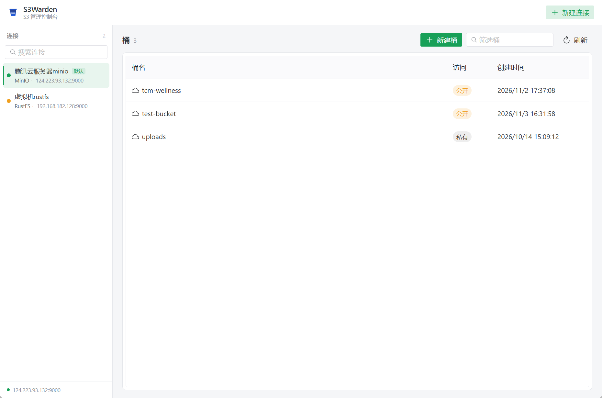
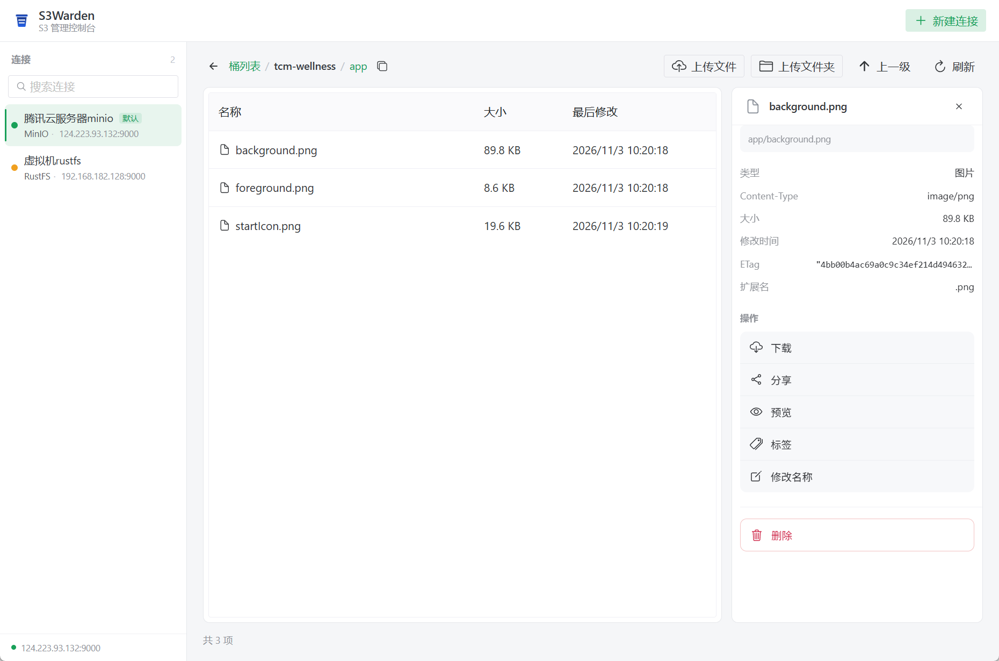

# S3Warden

[English](./README.en.md) | [中文](./README.md)

**An open-source desktop admin console for S3-compatible storage (MinIO / RustFS).**

More than an object browser — S3Warden puts management first: users, access keys, policies, groups, lifecycle rules and storage usage. It fills the gap left behind by the MinIO community console.

## Features

- **Admin-console first**: visual governance for users / access keys / policies / groups (P2+)
- **Dual backends**: MinIO and RustFS, with capability differences absorbed by the Rust core and reflected via capability switches in the UI
- **Secret safety**: Secret Keys live in the OS credential store (Windows Credential Manager / macOS Keychain / Linux Secret Service) and are never echoed back to the UI
- **Type-safe IPC**: TypeScript bindings generated by tauri-specta, with drift checks in CI
- **Lightweight**: Tauri 2 + Rust core

## Tech Stack

| Layer | Technology |
|---|---|
| Desktop shell | Tauri 2 |
| Core logic | Rust (standalone crate, all business logic) |
| S3 client | aws-sdk-s3 (unified addressing for MinIO / RustFS / generic S3) |
| IPC bindings | tauri-specta + specta |
| Frontend | Vue 3 + TypeScript + Pinia + Naive UI + Vite |
| Secret store | keyring (OS credential store) |

> Note on the S3 client: the original plan was minio-rs; we switched to aws-sdk-s3 for its maturity and full S3-compatible ecosystem coverage (explicit credentials + endpoint override; the AWS default credential chain is never touched).

## Current Features

Verified against a live MinIO instance:

- **Connections**: multiple profiles, connection test (latency + backend detection), edit/delete, default connection persistence; presets for MinIO / RustFS / generic S3; Path-Style / Virtual-Host addressing; automatic `http://` prefixing
- **Buckets**: bucket list with public/private access tags, create bucket (naming rules enforced), delete bucket (non-empty buckets require confirmation, then wiped via DeleteObjects), bucket policy (public/private switch; original policy JSON viewable and copyable)
- **Browsing**: prefix navigation, breadcrumbs with level-up, virtual scrolling, server-side pagination
- **Objects**: upload files/folders (streamed through Rust), download, rename (objects and folders), delete (with confirmation), object tags, metadata details (size / ETag / Content-Type / storage class), share via presigned URLs (10 min ~ 7 days), image / audio / video / text preview
- **Security**: Secret Keys live in the OS credential store; plaintext never appears in config files or IPC payloads

The admin console (users / access keys / policies / groups / lifecycle) is planned — see [FEATURES.md](./FEATURES.md).

| Main window | Object details |
|---|---|
|  |  |

## Install

### Download the installer (recommended)

Grab `S3Warden_x.y.z_x64-setup.exe` from [Releases](../../releases) (Windows 10/11 x64):

1. Double-click to install into your user profile (no admin rights, no UAC prompt)
2. Uninstall via Windows "Settings → Apps → Installed apps"
3. Connection data stays on your machine: `%APPDATA%\s3warden\connections.json` + the OS credential manager, isolated per Windows account; uninstalling the app does not delete connection data

> The installer is not code-signed yet; if SmartScreen warns on first run, choose "More info → Run anyway".

### Build from source

See [Development](#development) below; `pnpm tauri build` produces the same installer under `target/release/bundle/nsis/`.

## Development

Requirements: Node 22+ / pnpm / Rust stable (MSVC).

```sh
pnpm install
pnpm -C web install

pnpm tauri dev        # desktop app dev mode
pnpm web:typecheck    # frontend typecheck
pnpm web:build        # frontend build

# Re-export IPC bindings after changing Rust commands
cargo run -p s3warden --bin export-bindings
```

The generated `web/src/bindings.ts` is version-controlled; CI verifies it never drifts from the Rust side.

## Architecture

```
┌────────────────────────────────┐
│  Vue 3 + TS (UI)               │  typed bindings only, no secrets persisted
├────────────────────────────────┤
│  Tauri 2 shell (register/fwd)  │  no business logic
├────────────────────────────────┤
│  Rust Core (s3warden-core)     │  S3 ops / admin adapters / secrets / transfers
└────────────────────────────────┘
```

See [docs/开发文档.md](./docs/开发文档.md) (Chinese) and [FEATURES.md](./FEATURES.md) (feature status board).

## License

[MIT](./LICENSE)
