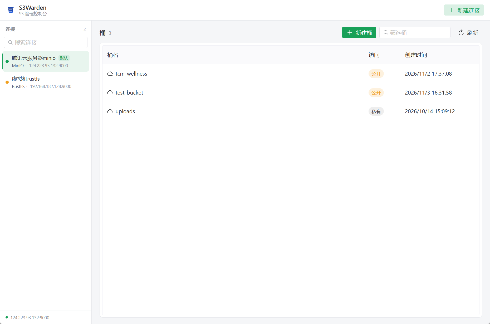
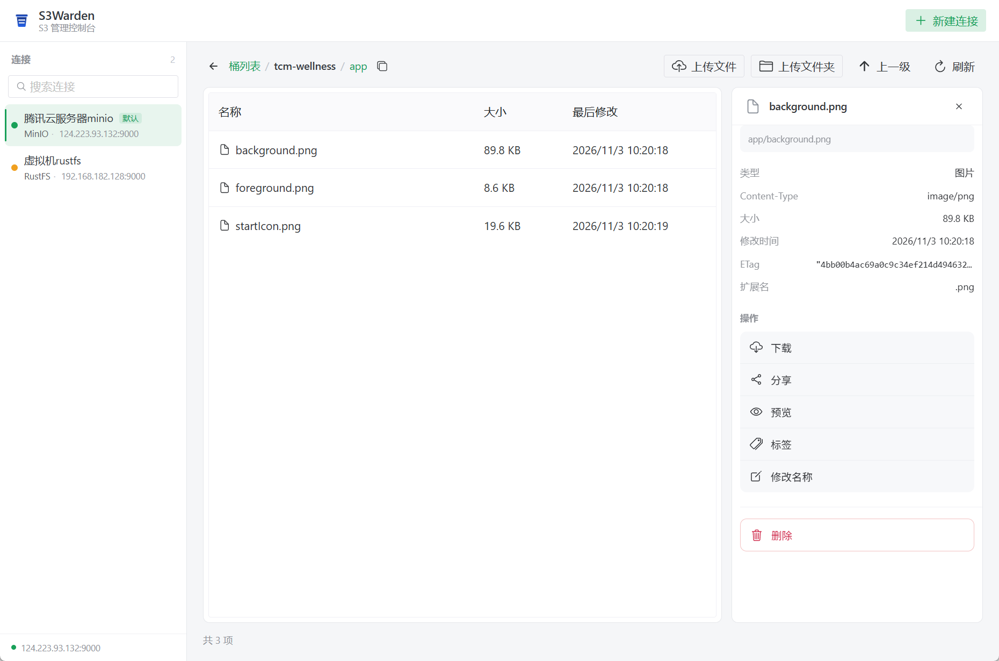

# S3Warden

[中文](./README.md) | [English](./README.en.md)

**面向 MinIO / RustFS 的开源桌面 S3 管理控制台。**

不只是对象浏览器——S3Warden 以「管理」为核心：用户、访问密钥、策略、分组、生命周期、存储用量。填补 MinIO 社区版控制台功能收缩后留下的空白。

## 特性

- **管理控制台优先**：用户 / Access Key / 策略 / 分组可视化治理（P2 起提供）
- **双后端**：同时适配 MinIO 与 RustFS，能力差异由核心层吸收、前端按能力显隐
- **密钥安全**：Secret Key 存操作系统凭据存储（Windows 凭据管理器 / macOS Keychain / Linux Secret Service），界面永不回显
- **类型安全 IPC**：tauri-specta 自动生成 TypeScript 绑定，CI 防契约漂移
- **轻量**：Tauri 2 + Rust 核心，启动快、体积小

## 技术栈

| 层级 | 技术 |
|---|---|
| 桌面壳 | Tauri 2 |
| 核心逻辑 | Rust（独立 crate，业务全部收敛于此） |
| S3 客户端 | aws-sdk-s3（对 MinIO / RustFS / 通用 S3 兼容端点统一寻址） |
| IPC 绑定 | tauri-specta + specta |
| 前端 | Vue 3 + TypeScript + Pinia + Naive UI + Vite |
| 密钥存储 | keyring（系统凭据存储） |

> S3 客户端说明：开发文档原选型 minio-rs，因其成熟度尚不足以承载生产级桌面工具，改用对 S3 兼容生态支持最完善的 aws-sdk-s3（显式凭据 + 端点覆盖，不触碰 AWS 环境默认链）。

## 当前功能

已实机验证（MinIO）：

- **连接管理**：多连接并列、测试连接（延迟与后端识别）、编辑/删除、默认连接持久化；服务类型支持 MinIO / RustFS / 通用 S3；Path-Style / Virtual-Host 寻址；端点自动补全协议
- **桶管理**：桶列表（含公开/私有访问级别标签）、新建桶（命名规则校验）、删除桶（非空桶二次确认后清空删除）、桶权限（公开/私有切换，原策略 JSON 可查看与复制）
- **对象浏览**：前缀浏览、面包屑导航与逐级回退、虚拟滚动、服务端分页加载
- **对象操作**：上传文件/文件夹（Rust 侧流式传输）、下载、重命名（对象与文件夹）、删除（二次确认）、对象标签（Object Tagging）、详情元数据（大小 / ETag / Content-Type / 存储类型）、分享（预签名 URL，10 分钟 ~ 7 天有效期）、图片 / 音视频 / 文本预览
- **安全**：Secret Key 存系统凭据存储，配置文件与 IPC 契约中永不出现明文

管理控制台（用户 / Access Key / 策略 / 分组 / 生命周期）见 [FEATURES.md](./FEATURES.md) 规划，后续版本提供。

| 主界面 | 对象详情 |
|---|---|
|  |  |

## 安装

### 下载安装包（推荐）

从 [Releases](../../releases) 下载 `S3Warden_x.y.z_x64-setup.exe`（Windows 10/11 x64）：

1. 双击运行，安装到当前用户目录（无需管理员权限，不会弹 UAC）
2. 卸载：系统「设置 → 应用 → 添加或删除程序」中移除 S3Warden
3. 连接数据保存在本机：`%APPDATA%\s3warden\connections.json` + 系统凭据管理器，随 Windows 账户隔离，卸载软件不会自动删除连接数据

> 安装包未做代码签名，首次运行如遇 SmartScreen 提示，选择「更多信息 → 仍要运行」。

### 从源码构建

见下方[开发](#开发)章节；执行 `pnpm tauri build` 后在 `target/release/bundle/nsis/` 得到同样的安装程序。

## 开发

依赖：Node 22+ / pnpm / Rust stable (MSVC)。

```sh
# 安装依赖（根目录 tauri-cli + web 前端）
pnpm install
pnpm -C web install

# 桌面应用开发模式（自动拉起 vite 与 Rust）
pnpm tauri dev

# 前端类型检查 / 构建
pnpm web:typecheck
pnpm web:build

# 重新导出 IPC 绑定（Rust command 变更后）
cargo run -p s3warden --bin export-bindings
```

生成的 `web/src/bindings.ts` 纳入版本管理，CI 会检查其与 Rust 端是否漂移。

## 架构

```
┌────────────────────────────┐
│  Vue 3 + TS（界面与交互）    │  只调用生成的类型化绑定，不持久化密钥
├────────────────────────────┤
│  Tauri 2 薄壳（注册/转发）   │  无业务逻辑
├────────────────────────────┤
│  Rust Core（s3warden-core） │  S3 操作 / 管理 API 适配 / 密钥 / 传输
└────────────────────────────┘
```

详见 [docs/开发文档.md](./docs/开发文档.md) 与 [FEATURES.md](./FEATURES.md)（功能状态看板）。

## License

[MIT](./LICENSE)
